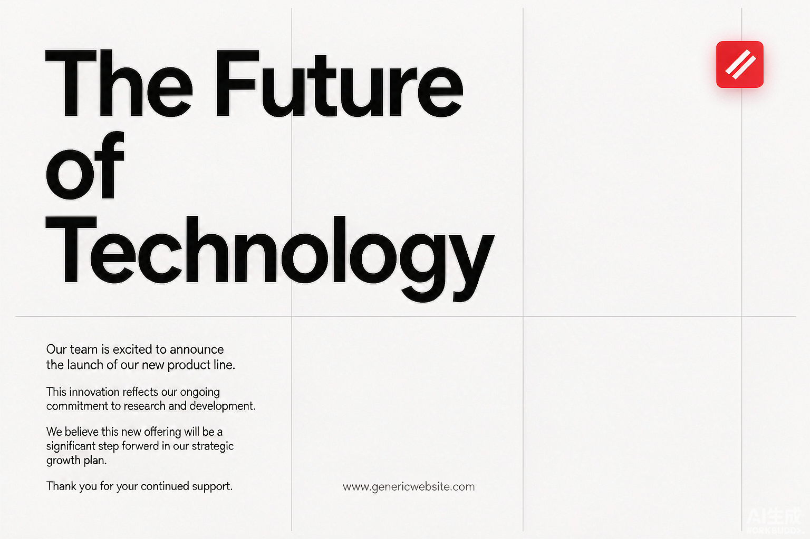
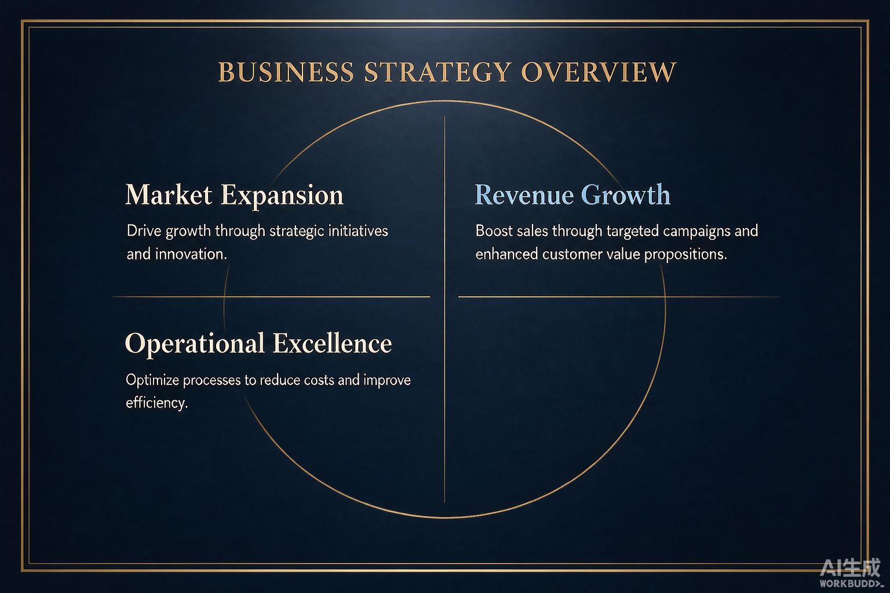
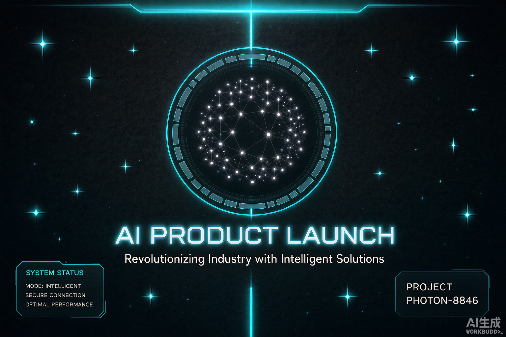
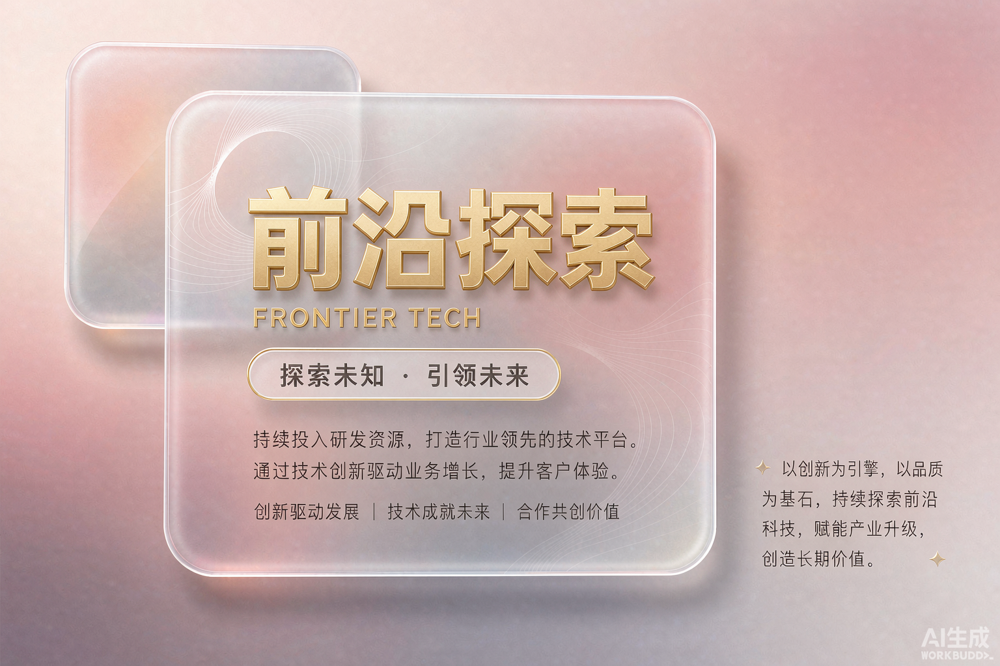
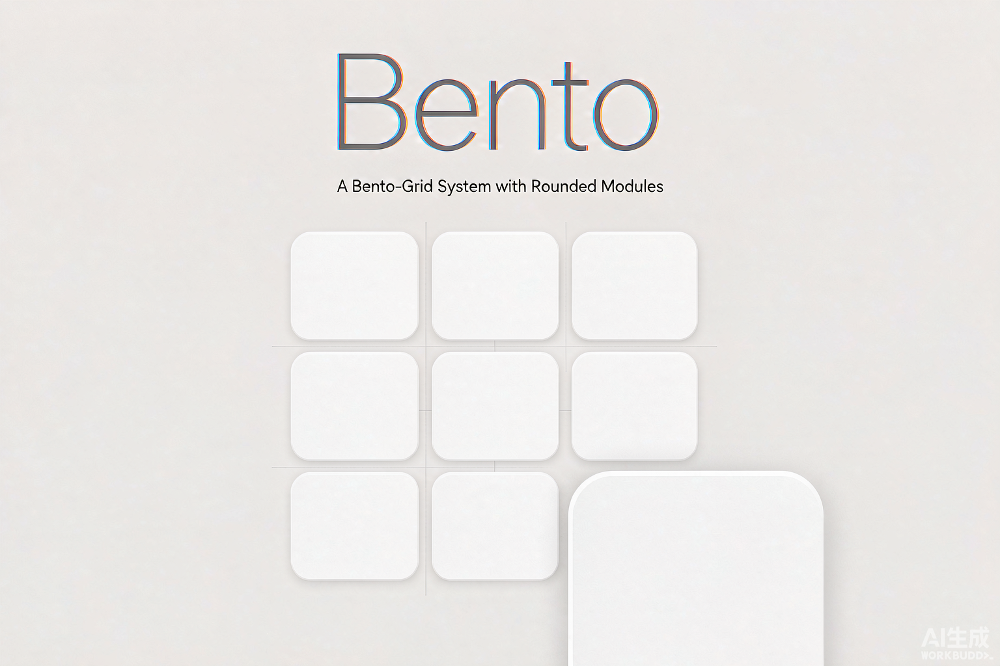
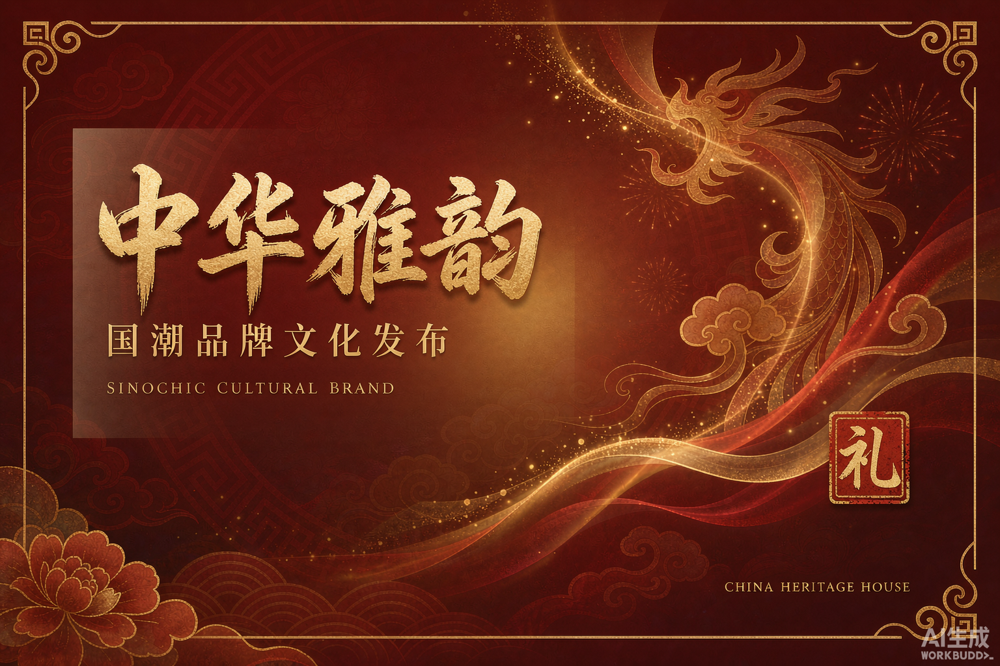
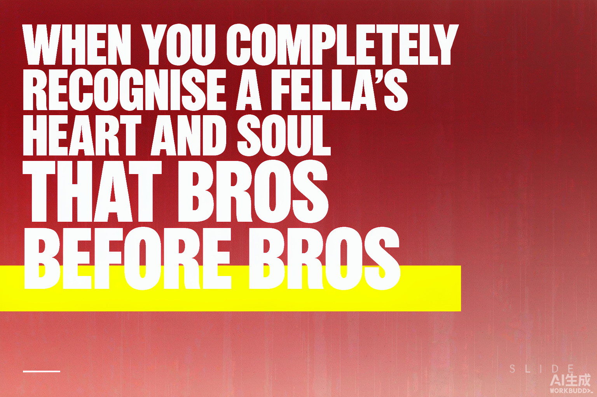

# 夜秣PPT工坊（可编辑PPT生成）

> 给一个标题，出品一本**可编辑的 PPTX**——不是图片拼的，是真 PPT，拿回去随便改。

   

## ⚠️ 购买前必读

| 事项 | 说明 |
|---|---|
| 💰 计费方式 | **9.90 元 / 册**，支付宝「AI 付」按次结算 |
| 💳 支付渠道 | **仅支持支付宝**。首次使用需在支付宝开通一次「AI 付」钱包授权，之后自动扣款 |
| 🌏 网络限制 | **服务端位于中国大陆丨海外网络环境无法使用** |
| 📦 本仓库是什么 | 技能客户端——负责连接服务端获取支付宝付款码、提交凭证取货；**实际生成全部在服务端完成** |

## 🌟 核心优势

| 做 PPT 的塌方点 | 夜秣PPT工坊怎么接住 |
|---|---|
| AI 出的 PPT 是一张张图片，字都改不了 | **真·可编辑 PPTX**：文本、版式、配色拿回去随便改 |
| 风格土、套模板一眼假 | **17 种设计风格 + 20 种版式**，按主题匹配 |
| 还要自己找配图 | **配图全包**，出册即成品 |
| 流程黑箱，怕乱扣费 | **quote → pay → prove 三步**：先报价确认，未经确认不发起真实付款；订单幂等，同单重试不重复扣费 |

> 一句话：**不是帮你"生成几张幻灯片图"，而是交付一本能继续编辑的真 PPT。**

## 💡 工作原理（三步走）

```
1. quote  → 客户端连服务端，拿到本单报价与支付宝付款码
2. pay    → 支付宝扫码付款
3. prove  → 凭付款凭证取货，服务端交付 PPTX 下载链接
```

## 🚀 安装

**SkillHub 一键装（推荐）**：WorkBuddy 技能市场搜 `yemo-ppt`，或直接下载：

```
https://api.skillhub.cn/api/v1/download?slug=yemo-ppt
```

**手动安装**：

```bash
git clone https://github.com/mcm369568095-hash/yemo-ppt.git
```

**怎么触发**：对 WorkBuddy 说「做个PPT」「把这份材料做成PPT」「按风格出一套PPT」。

## 🎨 17 种设计风格（完整清单）

出 PPT 时只要把 **key** 写进 brief（如 `"style": "swiss"`），整套幻灯片即套用该风格；另有 1 个 `custom` 自定义填空位。下面 8 张是 AI 生成的风格样图，17 种全量清单紧随其后：

### 风格样图（AI 生成示例幻灯片）

| 瑞士国际主义 | 深海蓝金 | 暗色科技 | 玻璃拟态 |
|---|---|---|---|
|  |  |  |  |
| Bento 网格 | 儿童手绘 | 国潮 | 大字报 |
|---|---|---|---|
|  |  |  |  |

### 完整 17 种设计风格清单

| key | 风格 | 气质 | 最适合 | 主题底色 |
|---|---|---|---|---|
| `kids_hand` | 儿童手绘（原厂） | 明亮童趣、夸张表情、蜡笔质感 | 主题班会 / 幼小教育 / 校园活动 / 安全科普 | 浅色 |
| `swiss` | 瑞士国际主义 | 理性克制、严格网格、一抹红 | 咨询报告 / 金融分析 / 董事汇报 / 数据陈述 | 浅色 |
| `navy_gold` | 深海蓝金 | 高端、稳重、金色点缀 | 融资计划书 / 年度总结 / 高管汇报 / 品牌发布 | 暗色 |
| `mono_min` | 极简黑白 | 克制、留白、字即是图 | 个人 IP / 高端品牌 / 作品集 / 理念宣讲 | 浅色 |
| `editorial` | 编辑杂志风 | 纸媒质感、衬线大标题、栏式排版 | 年度报告 / 品牌故事 / 文化分享 / 深度长文 | 浅色 |
| `bento` | Bento 网格 | 模块化、信息密度高、Apple 风 | 产品 overview / 数据看板 / 功能介绍 / 投资更新 | 浅色 |
| `glass` | 玻璃拟态 | 通透、层次、轻奢科技 | SaaS 产品 / AI 工具介绍 / 官网风演示 | 浅色 |
| `dark_tech` | 暗色科技 | 深色底、霓虹点缀、硬核未来 | AI 产品发布 / 技术分享 / 开发者大会 / 安全主题 | 暗色 |
| `aurora` | 极光霓虹 | 梦幻、流动光带、未来感 | 前沿科技 / 概念发布 / 创意提案 / 青年文化 | 暗色 |
| `blueprint` | 建筑蓝图 | 精确、工程感、线稿标注 | 技术方案 / 系统架构 / 工程规划 / 流程规范 | 浅色 |
| `academic` | 学术深蓝 | 严谨、规范、框架清晰 | 论文答辩 / 课题汇报 / 医疗科研 / 培训讲义 | 浅色 |
| `clay` | 黏土 3D | 柔软、亲和、手工质感 | 产品介绍 / 教育课件 / 生活方式 / 团队建设 | 浅色 |
| `riso` | 复古波普 | 网点印刷、撞色、复古俏皮 | 创意营销 / 独立出版 / 音乐活动 / 品牌联名 | 浅色 |
| `memphis` | 孟菲斯几何 | 撞色、几何铺陈、年轻张扬 | 校园活动 / 年轻品牌 / 节日营销 / 创意提案 | 浅色 |
| `guochao` | 国潮 | 中国红金、传统纹样、庄重喜庆 | 政务汇报 / 节庆活动 / 文化品牌 / 年度报告 | 浅色 |
| `organic` | 有机自然 | 温润、植物、手作质感 | 生态环保 / 健康养生 / 食品农业 / 民宿文旅 | 浅色 |
| `typo_bold` | 大字报 | 超大标题、极简底、强观点 | 观点演讲 / 发布会 / 口号墙 / 金句页 | 浅色 |
| `custom` | 自定义风格 | 客户自填 | 任何预设之外的风格 | 浅色 |

> 推荐时**一次给三个**：一个最稳的、一个最有记忆点的、一个最贴客户行业的，让客户挑，别一次甩 17 个。

## 📜 版权

本仓库内容版权归 **夜秣** 所有，仅供安装与个人使用，**禁止倒卖、二次分发或去除付费逻辑**。

## 📮 关注公众号「夜秣AI搞钱」


> 更多 AI 实战技能与拆解，微信搜一搜「夜秣AI搞钱」。
